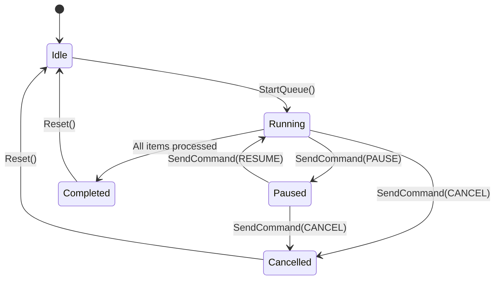

# AppLauncher3 — Test Matrix & Verification Architecture

## 1. Executive Verification Strategy
This document specifies the verification plan, input boundary matrices, adverse fault injection scenarios, and environment build matrices for **AppLauncher3**. 

The verification strategy is structured across three core test tiers:
1. **Hermetic Unit Tests:** Validating data contracts, JSON serialization, validation invariants, CLI flag parsing, and time calculation routines with zero external side effects.
2. **Process Engine & Concurrency Tests:** Validating asynchronous queue execution, pause/resume signaling, detached process spawning, thread safety (`go test -race`), and the "Continue with Warning" fault isolation policy.
3. **Storage & Resiliency Tests:** Validating atomic file writes, simulated file permission locks, corrupt JSON state recovery, and cross-platform path resolution.

---

## 2. Subsystem Test Matrices

### [VERIFY-01]: Data Models & JSON Schema Invariants
- **Target Component:** `pkg/models/config.go`, `pkg/models/item.go`, `pkg/models/profile.go`
- **Classifications:** Unit, Boundary Isolation, Schema Invariants.

#### Input Boundary Matrix
| Test Case ID | Category | Input Vector / State | Expected Behavior & Contract |
| :--- | :--- | :--- | :--- |
| **TC-MOD-01** | Happy Path | Standard valid `LauncherConfig` with 2 profiles, 3 items each | Serializes to valid JSON matching schema; deserializes back with identical field equality. |
| **TC-MOD-02** | Boundary (Zero) | `delaySeconds = 0.0` | Allowed; item launches and queue advances immediately to subsequent item with zero artificial delay. |
| **TC-MOD-03** | Boundary (Negative) | `delaySeconds = -5.0` | Validation error `ErrNegativeDelay`; rejected during validation before saving or queue execution. |
| **TC-MOD-04** | Boundary (Empty) | Profile with `name = ""` or `items = []` | Validation rejects empty profile name with `ErrEmptyProfileName`. Empty items list is valid (idle profile). |
| **TC-MOD-05** | Boundary (Duplicate) | Two profiles with identical name `"Default"` | Validation rejects with `ErrDuplicateProfileName`. |
| **TC-MOD-06** | Special Chars | Item `arguments = ["--title=\"My App\"", "file with spaces.txt", "\\path\\to\\dir"]` | Properly escaped in JSON array; preserved verbatim without quote stripping upon deserialization. |
| **TC-MOD-07** | ID Assignment | `LaunchItem` instantiated without UUID | Default constructor generates valid RFC 4122 v4 UUID string. |

---

### [VERIFY-02]: Storage Repository & Atomic Persistence
- **Target Component:** `pkg/storage/config_manager.go`
- **Classifications:** Integration, I/O Fault Injection, Atomic File Semantics.

#### Input Boundary & Fault Injection Matrix
| Test Case ID | Category | Scenario / Injection | Expected Behavior & Contract |
| :--- | :--- | :--- | :--- |
| **TC-STO-01** | Happy Path | Save updated configuration to disk | Writes to `config.json.tmp.<pid>`, fsyncs, and atomically renames to `config.json`. File contains valid JSON. |
| **TC-STO-02** | Resolution Order | Portable `config.json` exists in binary directory | Portable path takes precedence over system config path (`~/.config/applauncher3/config.json`). |
| **TC-STO-03** | Resolution Fallback | No portable file; OS config directory does not exist | Automatically creates directory tree with `0755` permissions and initializes default `config.json`. |
| **TC-STO-04** | Fault Injection (Corrupt JSON) | `config.json` contains truncated/malformed JSON bytes | Read fails with `ErrMalformedConfig`; engine preserves corrupt file as `config.json.corrupt.<timestamp>` and loads default in-memory config. |
| **TC-STO-05** | Fault Injection (Read-Only) | Directory or target file has `0444` (read-only) permissions | Save operation returns structured `ErrPermissionDenied`; original configuration file remains uncorrupted. |
| **TC-STO-06** | Concurrency Stress | 20 goroutines calling `Save()` concurrently | Mutex lock prevents file write collisions; final disk state matches latest state with zero race conditions. |

---

### [VERIFY-03]: Process Spawner & OS Detachment
- **Target Component:** `pkg/runner/spawner_*.go`
- **Classifications:** OS Integration, Process Isolation, Lifecycle Detachment.

#### Boundary & Process Execution Matrix
| Test Case ID | Category | Execution Vector / State | Expected Behavior & Contract |
| :--- | :--- | :--- | :--- |
| **TC-SPW-01** | Happy Path | Launch existing executable (e.g. `/bin/sh` or `echo`) | Process spawns; returns valid OS PID; child starts execution. |
| **TC-SPW-02** | Detachment | Parent process exits immediately after spawning child | Child process remains alive (`kill -0 <pid>` succeeds) and reparents to system init/subreaper. |
| **TC-SPW-03** | Missing Binary | Target executable does not exist (`/opt/nonexistent/app`) | Returns `os.ErrNotExist` / `exec.ErrNotFound`; process runner catches error without panic. |
| **TC-SPW-04** | Permission Denied | Target file exists but lacks executable bit (`chmod 0644`) | Returns `os.ErrPermission`; process runner flags item as `Failed` with diagnostic message. |
| **TC-SPW-05** | Working Directory | Custom `workingDirectory = "/tmp"` specified | Child process executes with CWD set to `/tmp` (verified via `/proc/<pid>/cwd` on Linux). |
| **TC-SPW-06** | Invalid Working Dir | Specified `workingDirectory` does not exist | Returns explicit directory error; flags item failed with descriptive error log. |

---

### [VERIFY-04]: Queue Engine & State Machine
- **Target Component:** `pkg/runner/engine.go`
- **Classifications:** Concurrency, Timing Determinism, State Invariant Verification (`-race`).



#### Queue Control & Timing Matrix
| Test Case ID | Category | Scenario / State Transition | Expected Behavior & Contract |
| :--- | :--- | :--- | :--- |
| **TC-QUE-01** | Happy Path | Execute 3 items with 50ms delay each | Items execute sequentially; each delay respected; queue transitions `Idle -> Running -> Completed`. |
| **TC-QUE-02** | Fault Policy | Item 2 of 4 fails to launch (missing binary) | **Continue with Warning:** Item 2 flagged `Failed` with error string; delay elapsed; Items 3 and 4 execute successfully. |
| **TC-QUE-03** | Pause & Resume | Pause command dispatched while Item 2 is delaying | Queue pauses; timer halts; no downstream item executes. Resume command restarts execution within `< 5ms`. |
| **TC-QUE-04** | Cancellation | Cancel command dispatched during queue execution | Active delay terminates immediately; remaining unstarted items flagged `Cancelled`; queue transitions to `Cancelled`. |
| **TC-QUE-05** | Dry Run Mode | `--dry-run` flag active | Engine simulates all item timings and progress events; zero actual OS processes are spawned. |
| **TC-QUE-06** | Concurrency Race Check | Rapid interleaved `Pause`/`Resume`/`Cancel` commands under `go test -race` | Zero data races detected; internal condition variables and atomic state flags remain coherent. |

---

### [VERIFY-05]: CLI Flag Parsing & Diagnostic Logger
- **Target Component:** `pkg/cli/flags.go`, `pkg/logger/logger.go`
- **Classifications:** Unit, CLI Boundary Parsing, Diagnostic Stream Logging.

#### CLI & Logging Matrix
| Test Case ID | Category | Input Flag Vector | Expected Behavior & Contract |
| :--- | :--- | :--- | :--- |
| **TC-CLI-01** | Happy Path | `--autostart --config /tmp/test.json --debug` | Options struct sets `AutoStart: true`, `ConfigPath: "/tmp/test.json"`, `DebugLogging: true`. |
| **TC-CLI-02** | Short Aliases | `-a -c /tmp/test.json -d -m` | Properly resolves `-a` (autostart), `-c` (config), `-d` (debug), `-m` (minimized). |
| **TC-CLI-03** | Missing Flag Arg | `--config` without trailing path argument | Returns explicit error code 2; prints usage message without crashing. |
| **TC-CLI-04** | Unknown Flag | `--unrecognized-flag-xyz` | Returns exit code 2; prints unknown flag warning. |
| **TC-LOG-01** | Thread-Safe Log | 10 Goroutines writing 100 log lines concurrently | `launcher-debug.log` contains exactly 1,000 serialized log lines with timestamps and severity prefixes without line interleaving. |

---

### [VERIFY-06]: Frontend UI Components & Reactive State (Svelte 5)
- **Target Component:** `frontend/src/` (Svelte 5 Runes, Store State, Component Tree)
- **Classifications:** Component Unit, Mocked IPC Integration, DOM Event Testing.

#### Frontend Reactive State & Interaction Matrix
| Test Case ID | Category | Interaction / State Trigger | Expected Behavior & Contract |
| :--- | :--- | :--- | :--- |
| **TC-UI-01** | Queue Reorder | User clicks "Move Up" on first item (Index 0) | Button disabled or action no-op; array indices unchanged. |
| **TC-UI-02** | Queue Reorder | User clicks "Move Down" on last item (Index N-1) | Button disabled or action no-op; array indices unchanged. |
| **TC-UI-03** | Drag & Drop | User drags Item A from Index 3 to Index 1 | Queue array reorders reactively; new order immediately persisted via IPC `SaveProfile()`. |
| **TC-UI-04** | File Picker Modal | User clicks "Browse" and selects binary | IPC invokes `runtime.OpenFileDialog`; returns path; auto-infers Friendly Name and Working Directory. |
| **TC-UI-05** | File Picker Cancel | User clicks "Browse" and closes native dialog without selection | State retains previous path; no null-pointer exception or error state displayed. |
| **TC-UI-06** | Profile Switcher | User selects different profile from dropdown | Queue table instantly repopulates with selected profile's items; active profile updated in state. |
| **TC-UI-07** | Progress Telemetry | Backend emits `QueueProgress` event (`current=2`, `total=5`, `delayRemaining=1.4s`) | Progress bar updates to 40%; status badge displays "Launching Item 2 of 5 (1.4s remaining)". |
| **TC-UI-08** | Dark/Light Mode | System theme changes between dark and light | Tailwind `dark` class toggles reactively; UI matches host system theme without app restart. |

---

### [VERIFY-07]: Desktop Lifecycle & System Tray Integration
- **Target Component:** `pkg/tray/tray.go`, Wails Window Events
- **Classifications:** Desktop Integration, Window Lifecycle, System Notifications.

#### Desktop & System Tray Matrix
| Test Case ID | Category | Event / Action Trigger | Expected Behavior & Contract |
| :--- | :--- | :--- | :--- |
| **TC-TRY-01** | Minimize to Tray | User closes main window when `closeToTray = true` | Window hides from taskbar; process remains running; tray icon remains active. |
| **TC-TRY-02** | Restore Window | User clicks tray icon or selects "Show AppLauncher3" | Main window unhides and restores focus to foreground. |
| **TC-TRY-03** | Quick Launch | User clicks "Start Current Queue" in tray context menu | Triggers backend execution engine immediately without opening main window. |
| **TC-TRY-04** | Tray Progress Tooltip| Queue execution step changes (`Step 3 of 5`) | Tray menu/tooltip updates dynamically to show real-time progress text. |
| **TC-TRY-05** | Notification | Queue finishes execution | Dispatches OS-native notification ("Queue Execution Completed: 5 items launched"). |


---

## 3. Environment & Compiler Build Matrix

| Target OS | Toolchain / Compiler | Architecture | Build Command / Flags | Sanitizer & Check Pipeline |
| :--- | :--- | :--- | :--- | :--- |
| **Linux (Arch/Ubuntu)** | Go 1.22+ / GCC 14+ | `amd64`, `arm64` | `go build -tags webkit2_41` | `go test -race -v ./...`<br>`golangci-lint run` |
| **Windows** | Go 1.22+ / MinGW-w64 | `amd64` | `go build -ldflags "-H windowsgui"` | `go test -race -v ./...` |
| **macOS** | Go 1.22+ / Apple Clang | `arm64`, `amd64` | `go build` | `go test -race -v ./...` |

---

## 4. Test Execution Recipes

```bash
# 1. Hermetic Unit Tests (Models & CLI)
go test -v -cover ./pkg/models/... ./pkg/cli/...

# 2. Storage Fault Injection & Atomic Semantics
go test -v -cover ./pkg/storage/...

# 3. Process Runner, Engine & Concurrency Race Detection
go test -v -race -timeout 30s ./pkg/runner/...

# 4. Frontend Component & Store Tests
cd frontend && npm test

# 5. Full Comprehensive Backend Coverage Summary
go test -v -race -coverprofile=coverage.out ./...
go tool cover -func=coverage.out
```

---

**Next Logical Skill in Progression:** `task-decomposer` (To break down the verified specification and test matrix into sequentially ordered, atomic implementation tasks with concrete acceptance criteria).
