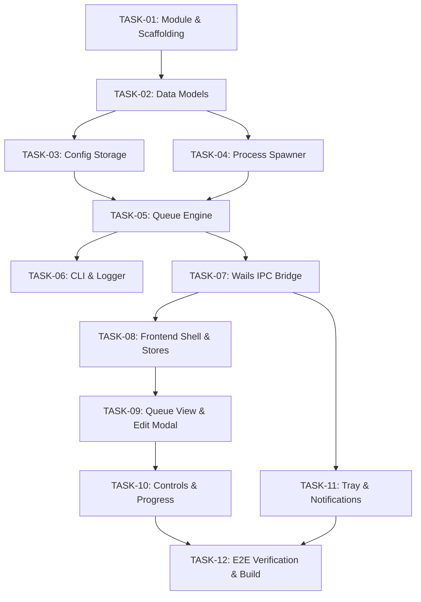

# AppLauncher3 — Atomic Implementation Task Breakdown

This document decomposes the architecture specification ([.planning/01-specification.md](file:///home/tpsapp/Documents/Projects/antigravity/applauncher-3/.planning/01-specification.md)) and test matrix ([.planning/03-test-matrix.md](file:///home/tpsapp/Documents/Projects/antigravity/applauncher-3/.planning/03-test-matrix.md)) into sequentially ordered, atomic implementation tasks.

---

## Task Dependency Graph



---

## Phase 1: Core Foundation & Data Engine

### [TASK-01]: Initialize Go Module & Wails Project Scaffolding

- **Prerequisites:** None (verified local Go 1.27.3, GCC, WebKit2GTK 4.1, Node.js).
- **Target Files:**
  - Create: `go.mod`, `wails.json`, `main.go`, `frontend/package.json`
- **Scope & Objective:** Scaffold the root Go module and Wails v2 project structure configured with Svelte 5 and TypeScript. Excludes UI implementation or spawner logic.
- **Interface / Contract:**
  ```json
  // wails.json
  {
    "$schema": "https://wails.io/schemas/config.v2.json",
    "name": "applauncher3",
    "outputfilename": "applauncher3",
    "frontend:install": "npm install",
    "frontend:build": "npm run build",
    "frontend:dev:watcher": "npm run dev",
    "frontend:dev:serverUrl": "auto",
    "author": { "name": "Thomas Sapp" },
    "info": { "companyName": "Sappsworld Programming", "productName": "AppLauncher3", "version": "3.0.0" }
  }
  ```
- **Behavior & Edge Cases:**
  - Configures build tags to link with `webkit2gtk-4.1` on Linux via `-tags webkit2_41`.
  - Ensures standard directory hierarchy: `pkg/models/`, `pkg/storage/`, `pkg/runner/`, `pkg/cli/`, `pkg/logger/`, `frontend/`.
- **Verification & Acceptance Criteria:**
  - [ ] `go env` recognizes module `github.com/tpsapp/applauncher3`.
  - [ ] Wails compiles base desktop binary without CGO linker errors:
    ```bash
    go build -tags webkit2_41 -o /dev/null main.go
    ```

---

### [TASK-02]: Implement Core Data Models & Validation (`pkg/models`)

- **Prerequisites:** [TASK-01]
- **Target Files:**
  - Create: `pkg/models/config.go`, `pkg/models/profile.go`, `pkg/models/item.go`, `pkg/models/models_test.go`
- **Scope & Objective:** Define data structures (`LauncherConfig`, `Profile`, `LaunchItem`), UUID generator, validation methods (`Validate() error`), and default factory functions. Excludes disk I/O.
- **Interface / Contract:**
  ```go
  package models

  type WindowState string
  const (
      WindowNormal    WindowState = "Normal"
      WindowMinimized WindowState = "Minimized"
      WindowHidden    WindowState = "Hidden"
  )

  type LaunchItem struct {
      ID               string      `json:"id"`
      Name             string      `json:"name"`
      Path             string      `json:"path"`
      Arguments        []string    `json:"arguments"`
      WorkingDirectory string      `json:"workingDirectory"`
      DelaySeconds     float64     `json:"delaySeconds"`
      LaunchState      WindowState `json:"launchState"`
      Enabled          bool        `json:"enabled"`
  }

  type Profile struct {
      Name  string       `json:"name"`
      Items []LaunchItem `json:"items"`
  }

  type AppSettings struct {
      StartMinimized  bool   `json:"startMinimized"`
      CloseToTray     bool   `json:"closeToTray"`
      ConfirmOnCancel bool   `json:"confirmOnCancel"`
      Theme           string `json:"theme"` // "system", "dark", "light"
      DebugLogging    bool   `json:"debugLogging"`
  }

  type LauncherConfig struct {
      Version       int         `json:"version"`
      ActiveProfile string      `json:"activeProfile"`
      Settings      AppSettings `json:"settings"`
      Profiles      []Profile   `json:"profiles"`
  }

  func NewDefaultConfig() *LauncherConfig
  func (c *LauncherConfig) Validate() error
  ```
- **Behavior & Edge Cases:**
  - Automatically generates an RFC 4122 v4 UUID if `item.ID` is blank.
  - Rejects negative `delaySeconds` with `ErrNegativeDelay`.
  - Rejects empty `profile.Name` with `ErrEmptyProfileName`.
  - Rejects duplicate profile names with `ErrDuplicateProfileName`.
  - Allows empty `items` array without error.
- **Verification & Acceptance Criteria:**
  - [ ] Satisfies `TC-MOD-01` through `TC-MOD-07`.
  - [ ] Execution command:
    ```bash
    go test -v -cover ./pkg/models/...
    ```

---

### [TASK-03]: Implement Atomic Configuration Storage Repository (`pkg/storage`)

- **Prerequisites:** [TASK-02]
- **Target Files:**
  - Create: `pkg/storage/config_manager.go`, `pkg/storage/config_manager_test.go`
- **Scope & Objective:** Manage cross-platform configuration path discovery, schema validation, reading, and atomic writing (`.tmp` + `fsync` + atomic rename). Excludes process spawning.
- **Interface / Contract:**
  ```go
  package storage

  import "github.com/tpsapp/applauncher3/pkg/models"

  type ConfigManager struct {
      configPath string
      mu         sync.RWMutex
  }

  func NewConfigManager(customPath string) (*ConfigManager, error)
  func (m *ConfigManager) ResolvePath() string
  func (m *ConfigManager) Load() (*models.LauncherConfig, error)
  func (m *ConfigManager) Save(cfg *models.LauncherConfig) error
  ```
- **Behavior & Edge Cases:**
  - Path Resolution Hierarchy: custom path (`--config`) -> portable (`./config.json`) -> OS directory (`~/.config/applauncher3/config.json` on Linux, `%APPDATA%/AppLauncher3/config.json` on Windows).
  - Creates parent directories with `0755` permissions if missing.
  - Safe Write: writes to `<path>.tmp.<pid>`, fsyncs, renames to `<path>`.
  - Corrupt Recovery: if JSON is corrupt, renames file to `<path>.corrupt.<timestamp>` and returns default configuration.
- **Verification & Acceptance Criteria:**
  - [ ] Satisfies `TC-STO-01` through `TC-STO-06`.
  - [ ] Execution command:
    ```bash
    go test -v -cover ./pkg/storage/...
    ```

---

## Phase 2: Process Engine & Execution State Machine

### [TASK-04]: Implement Cross-Platform Detached Process Spawner (`pkg/runner`)

- **Prerequisites:** [TASK-01], [TASK-02]
- **Target Files:**
  - Create: `pkg/runner/spawner.go`, `pkg/runner/spawner_unix.go`, `pkg/runner/spawner_windows.go`, `pkg/runner/spawner_test.go`
- **Scope & Objective:** Provide the OS-specific abstraction for launching detached processes with argument arrays, window states, and working directories. Excludes queue sequencing.
- **Interface / Contract:**
  ```go
  package runner

  import "github.com/tpsapp/applauncher3/pkg/models"

  type ProcessSpawner interface {
      Spawn(item *models.LaunchItem) (int, error)
  }
  ```
- **Behavior & Edge Cases:**
  - Linux/macOS (`spawner_unix.go`): Sets `SysProcAttr{Setpgid: true}`, disconnects stdin/stdout/stderr pipes so parent exit does not kill child. Supports desktop shortcuts and scripts.
  - Windows (`spawner_windows.go`): Sets `SysProcAttr{CreationFlags: CREATE_NEW_PROCESS_GROUP | DETACHED_PROCESS}`, maps `LaunchState` to `ShowWindow` (SW_HIDE, SW_SHOWMINIMIZED).
  - Sets CWD to `item.WorkingDirectory` if provided; returns error if directory does not exist.
  - Catches missing executable (`os.ErrNotExist`) and permission denied (`os.ErrPermission`) cleanly.
- **Verification & Acceptance Criteria:**
  - [ ] Satisfies `TC-SPW-01` through `TC-SPW-06`.
  - [ ] Child processes remain alive when parent terminates.
  - [ ] Execution command:
    ```bash
    go test -v -cover ./pkg/runner/spawner_test.go ./pkg/runner/spawner*.go
    ```

---

### [TASK-05]: Implement Async Queue Engine State Machine (`pkg/runner`)

- **Prerequisites:** [TASK-03], [TASK-04]
- **Target Files:**
  - Create: `pkg/runner/engine.go`, `pkg/runner/engine_test.go`
- **Scope & Objective:** Coordinate sequential queue execution with delay timers, pause/resume signaling (`sync.Cond`), cancellation, progress callback events, and "Continue with Warning" fault isolation.
- **Interface / Contract:**
  ```go
  package runner

  type QueueState string
  const (
      StateIdle      QueueState = "Idle"
      StateRunning   QueueState = "Running"
      StatePaused    QueueState = "Paused"
      StateCancelled QueueState = "Cancelled"
      StateCompleted QueueState = "Completed"
  )

  type ProgressEvent struct {
      CurrentIndex   int         `json:"currentIndex"`
      TotalItems     int         `json:"totalItems"`
      CurrentItem    LaunchItem  `json:"currentItem"`
      ItemStatus     string      `json:"itemStatus"`
      State          QueueState  `json:"state"`
      DelayRemaining float64     `json:"delayRemaining"`
      ErrorMessage   string      `json:"errorMessage,omitempty"`
  }

  type Engine struct { ... }
  func NewEngine(spawner ProcessSpawner) *Engine
  func (e *Engine) Start(ctx context.Context, profile models.Profile, dryRun bool, onProgress func(ProgressEvent)) error
  func (e *Engine) Pause()
  func (e *Engine) Resume()
  func (e *Engine) Cancel()
  func (e *Engine) GetState() QueueState
  ```
- **Behavior & Edge Cases:**
  - Non-blocking pause: halts between queue items and within delay countdowns.
  - Instant cancellation: terminates active delay without spawning subsequent items.
  - Continue-with-Warning: if `spawner.Spawn()` returns an error, records `ErrorMessage`, marks item `Failed`, dispatches progress event, waits `DelaySeconds`, and advances to next item.
  - Dry run mode: executes exact delays and emits progress events without spawning OS processes.
- **Verification & Acceptance Criteria:**
  - [ ] Satisfies `TC-QUE-01` through `TC-QUE-06`.
  - [ ] Zero race conditions under ThreadSanitizer:
    ```bash
    go test -v -race -timeout 30s ./pkg/runner/...
    ```

---

## Phase 3: CLI, Diagnostics & Application Bridge

### [TASK-06]: Implement CLI Flag Parser & Diagnostic Logger (`pkg/cli`, `pkg/logger`)

- **Prerequisites:** [TASK-01], [TASK-02]
- **Target Files:**
  - Create: `pkg/cli/flags.go`, `pkg/cli/flags_test.go`, `pkg/logger/logger.go`, `pkg/logger/logger_test.go`
- **Scope & Objective:** Parse command-line flags and provide a thread-safe diagnostic trace log writer to `launcher-debug.log`. Excludes GUI rendering.
- **Interface / Contract:**
  ```go
  package cli

  type Options struct {
      AutoStart    bool
      ConfigPath   string
      DebugLogging bool
      DryRun       bool
      StartMinimized bool
  }

  func ParseArgs(args []string) (*Options, error)
  ```
  ```go
  package logger

  func InitLogger(logPath string, enabled bool) error
  func Debug(format string, v ...interface{})
  func Info(format string, v ...interface{})
  func Error(format string, v ...interface{})
  func Close() error
  ```
- **Behavior & Edge Cases:**
  - Recognizes flags: `-a` / `--autostart`, `-c <path>` / `--config <path>`, `-d` / `--debug`, `--dry-run`, `-m` / `--minimized`.
  - Writes timestamped entries: `[2026-11-06 14:15:00.123] [DEBUG] Spawn: /usr/bin/app args: [...]`.
  - Thread-safe mutex lock ensures zero interleaved lines under concurrent logging.
- **Verification & Acceptance Criteria:**
  - [ ] Satisfies `TC-CLI-01` through `TC-CLI-04` and `TC-LOG-01`.
  - [ ] Execution command:
    ```bash
    go test -v -cover ./pkg/cli/... ./pkg/logger/...
    ```

---

### [TASK-07]: Implement Wails IPC Backend Application Bridge (`app.go`)

- **Prerequisites:** [TASK-03], [TASK-05], [TASK-06]
- **Target Files:**
  - Create/Modify: `app.go`, `main.go`
- **Scope & Objective:** Bind Go services to Wails runtime. Expose RPC methods to frontend, wire Go event emitters (`wails/runtime.EventsEmit`), and handle native file dialogs.
- **Interface / Contract:**
  ```go
  type App struct {
      ctx        context.Context
      configMgr  *storage.ConfigManager
      engine     *runner.Engine
      cliOptions *cli.Options
  }

  func (a *App) GetConfig() (*models.LauncherConfig, error)
  func (a *App) SaveConfig(cfg *models.LauncherConfig) error
  func (a *App) StartQueue(profileName string) error
  func (a *App) PauseQueue()
  func (a *App) ResumeQueue()
  func (a *App) CancelQueue()
  func (a *App) SelectExecutableDialog() (string, error)
  func (a *App) SelectDirectoryDialog() (string, error)
  ```
- **Behavior & Edge Cases:**
  - Wires `engine.onProgress` to emit `"queue:progress"` event to frontend.
  - Native file picker invokes `runtime.OpenFileDialog(ctx, runtime.OpenDialogOptions{})`.
  - Honors `--autostart` on startup: triggers `StartQueue()` immediately after frontend startup event.
- **Verification & Acceptance Criteria:**
  - [ ] Wails Go bindings generate without error:
    ```bash
    wails generate module
    ```

---

## Phase 4: Modern Desktop UI (Svelte 5 + TypeScript + Tailwind)

### [TASK-08]: Configure Svelte 5 Frontend Shell, Theme & Store Architecture

- **Prerequisites:** [TASK-07]
- **Target Files:**
  - Create: `frontend/src/app.css`, `frontend/src/stores/configStore.ts`, `frontend/src/stores/queueStore.ts`, `frontend/src/App.svelte`
- **Scope & Objective:** Initialize Tailwind CSS, Svelte 5 reactive stores (using Runes `$state` and `$derived`), dark/light theme detector, and desktop layout shell. Excludes queue editing modal.
- **Interface / Contract:**
  ```typescript
  // stores/configStore.ts
  export interface ConfigStore {
      config: LauncherConfig | null;
      activeProfile: Profile | null;
      loading: boolean;
      load(): Promise<void>;
      setActiveProfile(name: string): Promise<void>;
      save(): Promise<void>;
  }

  // stores/queueStore.ts
  export interface QueueStore {
      state: "Idle" | "Running" | "Paused" | "Cancelled" | "Completed";
      currentIndex: number;
      totalItems: number;
      delayRemaining: number;
      itemStatuses: Record<string, string>;
  }
  ```
- **Behavior & Edge Cases:**
  - Subscribes to `"queue:progress"` backend events to dynamically update reactive state.
  - Synchronizes system color scheme with Tailwind `dark` class on `<html>`.
- **Verification & Acceptance Criteria:**
  - [ ] Frontend builds without TypeScript or Svelte errors:
    ```bash
    cd frontend && npm run build
    ```

---

### [TASK-09]: Build Queue Table, Reorder Controls & Add/Edit Item Modal with File Picker

- **Prerequisites:** [TASK-08]
- **Target Files:**
  - Create: `frontend/src/components/QueueList.svelte`, `frontend/src/components/QueueItemRow.svelte`, `frontend/src/components/ItemEditModal.svelte`
- **Scope & Objective:** Build the interactive queue items view with Move Up, Move Down, Delete, Insert at index, and the Add/Edit modal dialog featuring the native OS file browser button.
- **Behavior & Edge Cases:**
  - Boundary guards: "Move Up" disabled on first item; "Move Down" disabled on last item.
  - When user selects executable via native file picker, automatically populates `name` with file basename (without extension) and `workingDirectory` with parent directory.
  - Supports argument tagging and delay input slider (0 to 60 seconds).
- **Verification & Acceptance Criteria:**
  - [ ] Satisfies `TC-UI-01` through `TC-UI-06`.
  - [ ] Component unit tests pass:
    ```bash
    cd frontend && npm test
    ```

---

### [TASK-10]: Build Control Footer, Progress Telemetry & Status Badges

- **Prerequisites:** [TASK-09]
- **Target Files:**
  - Create: `frontend/src/components/ControlBar.svelte`, `frontend/src/components/ProgressBar.svelte`, `frontend/src/components/StatusBadge.svelte`
- **Scope & Objective:** Build the sticky execution footer with `Start`, `Pause`, `Resume`, and `Cancel` buttons, live execution step indicator (`Step 3 of 8`), delay countdown, and per-item status badges.
- **Behavior & Edge Cases:**
  - Button state machine:
    - When `Idle`: `Start` enabled, `Pause`/`Resume`/`Cancel` disabled.
    - When `Running`: `Start` disabled, `Pause` and `Cancel` enabled.
    - When `Paused`: `Resume` and `Cancel` enabled, `Pause` disabled.
  - Per-item status badges show: `Pending` (gray), `Running` (blue pulse), `Success` (green), `Failed` (red with error tooltip).
- **Verification & Acceptance Criteria:**
  - [ ] Satisfies `TC-UI-07` and `TC-UI-08`.
  - [ ] Progress calculation matches exact step percentage.

---

## Phase 5: System Tray & Packaging

### [TASK-11]: Integrate System Tray Controller & Native Desktop Notifications

- **Prerequisites:** [TASK-07], [TASK-10]
- **Target Files:**
  - Create: `pkg/tray/tray.go`, `pkg/tray/tray_unix.go`, `pkg/tray/tray_windows.go`
- **Scope & Objective:** Implement the native system tray menu (Show/Hide, Profile Switcher, Start Queue, Exit), window close-to-tray interception, and completion toast notifications.
- **Behavior & Edge Cases:**
  - When window close button is clicked and `closeToTray = true`, calls `runtime.WindowHide()` instead of quitting.
  - Tray tooltip dynamically updates during queue run (`AppLauncher3: Launching Item 2/5...`).
  - Emits desktop notification when queue completes or encounters a failed launch.
- **Verification & Acceptance Criteria:**
  - [ ] Satisfies `TC-TRY-01` through `TC-TRY-05`.
  - [ ] Clean minimize and restore cycles without window destruction.

---

### [TASK-12]: End-to-End Verification, Cross-Compilation & Release Packaging

- **Prerequisites:** All prior tasks ([TASK-01] through [TASK-11])
- **Target Files:**
  - Create: `Makefile`, `scripts/build_all.sh`, `tests/e2e/e2e_test.go`
- **Scope & Objective:** Provide the unified Makefile and build scripts to compile for Linux (`-tags webkit2_41`), Windows (`-ldflags "-H windowsgui"`), and macOS, plus complete end-to-end integration test execution.
- **Behavior & Edge Cases:**
  - Runs full automated end-to-end queue with mock tasks, verifies correct exit codes, and confirms diagnostic logs are written cleanly.
- **Verification & Acceptance Criteria:**
  - [ ] Full test suite passes:
    ```bash
    go test -v -race -cover ./...
    ```
  - [ ] Wails production build completes successfully:
    ```bash
    wails build -tags webkit2_41
    ```

---

**Next Logical Skill in Progression:** `post-mortem-auditor` (To audit the completed implementation deliverables against the specification, non-goals, and test matrices upon milestone completion).
