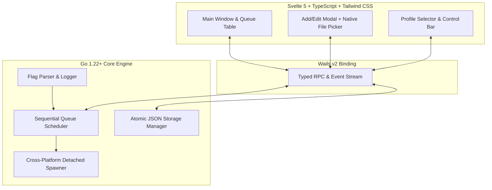

# AppLauncher3 🚀

A lightweight, modern, cross-platform desktop utility that automates the sequential, staggered launching of applications, scripts, and system commands.

[](https://go.dev/)
[](https://wails.io)
[](https://svelte.dev/)
[](https://tailwindcss.com/)
[](tests/)
[](LICENSE.md)

---

## 🌟 Overview

**AppLauncher3** is a complete, modern reimagining of the classic Windows Forms utility ([*AppLauncher2*](https://github.com/tpsapp/Applauncher2)). Re-engineered from the ground up for Linux, Windows, and macOS, it pairs a native Go backend with an ultra-responsive Svelte 5 frontend using Wails v2.

It produces a **7.0 MB self-contained binary** with zero external dependencies and idle memory usage of ~25 MB, avoiding the multi-hundred megabyte bloat of Electron.



---

## ✨ Key Features

* **Sequential Staggered Execution Queue**: Launch applications one by one with configurable per-item delays (0 to 60+ seconds), countdown timers, and live progress percentage tracking.
* **Detached Process Spawning**: Child processes are launched in isolated process groups (`SysProcAttr{Setpgid: true}` on POSIX; `CREATE_NEW_PROCESS_GROUP | DETACHED_PROCESS` on Windows). Closing or restarting the launcher leaves child applications running without interruptions or zombie processes.
* **Continue-with-Warning Fault Policy**: If an executable fails to spawn (e.g. invalid path or missing permissions), AppLauncher3 captures the error, flags the item, sends a desktop notification, records diagnostic trace logs, and automatically proceeds to the remaining queue items.
* **Multi-Profile Management**: Seamlessly configure, switch, and persist multiple launch profiles (e.g., *"Workstation"*, *"Development"*, *"Gaming"*, *"Kiosk"*).
* **Atomic JSON Storage**: Configurations are safely stored using an atomic write pipeline (`.tmp` + `fsync` + atomic rename) with automatic corrupt file quarantine, operating in standard OS user config directories (`%APPDATA%`, `~/.config`, `~/Library/Application Support`) and portable mode beside the executable.
* **Interactive Queue Ergonomics**: Drag-and-drop ordering, Move Up / Move Down buttons, active item toggling, and native file/directory dialogs with automatic name and working directory inference.
* **Desktop & System Tray Integration**: Minimize-to-tray close hook, system dark/light theme synchronization, and native OS desktop completion notifications.

---

## 💻 CLI Flags & Headless Support

AppLauncher3 provides CLI options for automated execution, system startup integration, and debugging:

```bash
# Automatically begin queue execution on launch
applauncher3 --autostart
applauncher3 -a

# Load a custom profile configuration file
applauncher3 --config /path/to/custom_config.json
applauncher3 -c /path/to/custom_config.json

# Launch directly minimized to the system tray
applauncher3 --minimized
applauncher3 -m

# Enable granular diagnostic trace logging to launcher-debug.log
applauncher3 --debug
applauncher3 -d

# Simulate the queue sequence and delays without spawning processes
applauncher3 --dry-run
```

---

## 🛠️ Building & Development

### Prerequisites
* **Go 1.22+**
* **Node.js 18+** & npm
* **GCC / Build Essentials**
* **WebKitGTK** (on Linux: `webkit2gtk-4.1` or `webkit2gtk-4.0`)

### Quick Build
```bash
# 1. Install frontend dependencies
cd frontend && npm install && cd ..

# 2. Build frontend and compile desktop binary
make

# Output binary located at bin/applauncher3
./bin/applauncher3
```

### Running Test Suite
```bash
# Run hermetic unit tests, fault injections, and concurrency race checks
make test-race
```

---

## 📂 Project Architecture

```
applauncher-3/
├── app.go                  # Wails RPC backend & event bridge
├── main.go                 # Desktop entry point & asset embedding
├── Makefile                # Build, test, and packaging recipes
├── wails.json              # Wails project manifest
├── pkg/
│   ├── cli/                # Command-line flag parsing (-a, -c, -d, -m, --dry-run)
│   ├── logger/             # Thread-safe diagnostic trace logger
│   ├── models/             # LauncherConfig, Profile, LaunchItem contracts & validation
│   ├── runner/             # Detached spawner (POSIX/Win32) & async queue state machine
│   ├── storage/            # Atomic JSON persistence & path discovery
│   └── tray/               # Cross-platform desktop notifications & tray hooks
├── frontend/
│   ├── src/                # Svelte 5 runes ($state, $derived), Tailwind CSS
│   │   ├── components/     # Header, ProfileBar, QueueTable, ItemModal, ControlBar
│   │   ├── api.ts          # Wails typed RPC abstraction & mock layer
│   │   └── App.svelte      # Root application orchestrator
└── tests/
    └── e2e/                # Full lifecycle end-to-end integration test suite
```

---

## 📄 License

This project is licensed under the [MIT License](LICENSE.md) — &copy; 2026 Thomas Sapp / Sappsworld Programming.
